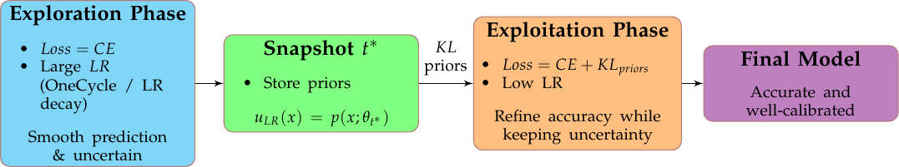

# LRIP: Learning Rate Informed Priors for Neural Network Calibration

**Mouhamadou Makhtar Fall, Samia Ainouz, Pierre-Jean Lapray, Jean-Philippe Tarel** — ICPR 2026

During the large learning-rate phase of training, a network's predictions are soft,
spread over related classes, and markedly better calibrated than at the end of
training. LRIP records these predictions once, at the learning-rate peak *t\**, and
reuses them as sample-specific priors for the rest of training, in place of the
uniform prior of label smoothing:

$$
\mathcal{L}(x_n) = (1-\varepsilon)\,\mathcal{L}_{CE}(y_n, p_n) + \varepsilon\, D_{KL}\big(u_{LR}(x_n)\,\|\,p_n\big),
\qquad u_{LR}(x_n) = p(x_n;\theta_{t^\*})
$$



* **One hyperparameter**, the smoothing strength ε (0.1 everywhere, 0.3 on 20 Newsgroups).
  *t\** is read from the learning-rate schedule: first decay epoch for step schedules,
  `pct_start × T` for OneCycle.
* **Cost**: one extra forward pass over the training set at *t\**, and an `N × K`
  float16 table of priors. No extra trainable parameters.
* Works for **image classification, text classification and semantic segmentation**.

## Install

```bash
conda create -n lrip python=3.9 -y && conda activate lrip
# install torch / torchvision for your CUDA version first: https://pytorch.org
pip install -e .            # add [nlp] for 20 Newsgroups, [test] for the unit tests
```

## Data

Datasets are expected under `./data` (override with `data.data_root=/abs/path`):

| Dataset | Path | Notes |
|---|---|---|
| CIFAR-10 | `data/cifar10` | downloaded automatically |
| Tiny-ImageNet | `data/tiny-imagenet-200` | |
| CUB-200-2011 | `data/CUB_200_2011` | |
| 20 Newsgroups | `data/20newsgroups` | with `20_newsgroups/` and `glove.6B/` |
| PASCAL VOC 2012 | `data/VOCdevkit/VOC2012` | |

## Usage

Training is driven by [Hydra](https://hydra.cc) configs in [`configs/`](configs). LRIP is
selected with `loss=lrip`:

```bash
# CIFAR-10, ResNet-50, 150 epochs, LR decay at 50 and 100  ->  t* = 50
python tools/train_net.py data=cifar10 model=resnet50_cifar loss=lrip \
    optim=sgd optim.lr=0.1 scheduler=multi_step "scheduler.milestones=[50,100]" train.max_epoch=150
```

The commands of every experiment of the paper (three seeds each) are in
[`scripts/paper.sh`](scripts/paper.sh):

```bash
bash scripts/paper.sh cifar10        # also: tiny_imagenet, cub, newsgroups, voc, ablation_sd
```

Each run writes its log, checkpoints and the recorded priors (`lrip_priors.pt`) to
`outputs/<dataset>/<model>-<loss>-<optim>/<date>/`. Training resumes from there with
`train.resume=True hydra.run.dir=<that folder>`, priors included. Test metrics (accuracy,
ECE, AECE, and mIoU for segmentation) are printed at the end, before and after
temperature scaling.

### LRIP options ([`configs/loss/lrip.yaml`](configs/loss/lrip.yaml))

| Option | Default | Meaning |
|---|---|---|
| `loss.epsilon` | `0.1` | weight ε of the KL term |
| `loss.snapshot_epoch` | `null` | epochs completed before the snapshot; `null` = LR peak from the scheduler. Set it to the second decay for the SD ablation (Table 5). |
| `loss.snapshot_view` | `train` | images seen by the snapshot: `train` (training transform) or `eval` (deterministic evaluation transform) |
| `loss.ignore_index` | `-100` | use `255` for VOC |
| `loss.prior_stride` | `8` | segmentation: prior maps are stored at 1/8 resolution in float16 |

### Use LRIP in your own training loop

```python
from calibrate.losses import LRIPLoss
from calibrate.lrip import collect_priors

criterion = LRIPLoss(epsilon=0.1)
priors = None
for epoch in range(max_epoch):
    if epoch == t_star:                       # LR peak
        model.eval()
        priors = collect_priors(((idx, x) for idx, x, _ in ordered_loader),
                                model, num_samples, num_classes, device)
    model.train()
    for idx, x, y in train_loader:            # the loader also yields sample indices
        logits = model(x.to(device))
        loss, ce, kl = criterion(logits, y.to(device),
                                 None if priors is None else priors.get(idx))
        ...
```

Before *t\** (`prior=None`) the loss is the plain cross-entropy.

## Implementation notes

* [`calibrate/losses/lrip.py`](calibrate/losses/lrip.py) — the objective, for `[N, K]` logits and
  `[N, K, H, W]` segmentation maps (ignored pixels excluded from both terms).
* [`calibrate/lrip/priors.py`](calibrate/lrip/priors.py) — *t\** from the schedule, snapshot and
  `PriorBank` (one float16 `[N, K]` tensor on the GPU, gathered by sample index).
* [`calibrate/lrip/segmentation.py`](calibrate/lrip/segmentation.py) — for segmentation, priors are
  recorded on the deterministic resized view of each image and go through the same random
  crop and flip as the image and its mask, so that every pixel keeps its own prior.
* OneCycle (`scheduler=one_cycle`) is stepped after every batch.

Unit tests (a few seconds on CPU): `pytest tests`.

## Results

| | CIFAR-10 R50 | | Tiny-ImageNet R50 | | CUB-200 R101 | | 20 NG | VOC 2012 | |
|---|---|---|---|---|---|---|---|---|---|
| Method | ACC | ECE | ACC | ECE | ACC | ECE | AECE | mIoU | ECE |
| CE | 94.65 | 3.35 | 64.77 | 3.37 | 68.97 | 9.53 | 16.32 | 70.92 | 8.26 |
| LS | 94.66 | 3.66 | 64.81 | 2.22 | 70.22 | 3.89 | 4.75 | 71.00 | 9.35 |
| MbLS | 94.45 | 1.44 | 64.69 | 2.19 | 69.72 | 2.10 | 4.83 | 71.20 | 7.94 |
| ACLS | 94.68 | 2.26 | 64.83 | **1.35** | 69.84 | 2.81 | 8.16 | 70.63 | 7.29 |
| **LRIP** | 94.24 | **1.25** | 64.30 | 1.55 | 67.27 | **1.77** | **2.99** | 71.17 | **6.59** |

ECE / AECE in %, 15 bins. Full tables in the paper.

## Acknowledgements

This code base builds on [MbLS](https://github.com/by-liu/MbLS) (Liu et al., CVPR 2022),
whose data pipelines, models and calibration metrics are reused; the baselines CE, LS,
FL and MbLS remain available through `loss=ce|ls|focal|logit_margin`. This work is
supported by the French ANR project INARI (ANR-23-CE22-0002); part of it was run on the
computing resources of CRIANN (Normandy, France).

## Citation

```bibtex
@inproceedings{fall2026lrip,
  title     = {Learning Rate Informed Priors for Neural Network Calibration},
  author    = {Fall, Mouhamadou Makhtar and Ainouz, Samia and Lapray, Pierre-Jean and Tarel, Jean-Philippe},
  booktitle = {International Conference on Pattern Recognition (ICPR)},
  year      = {2026}
}
```
